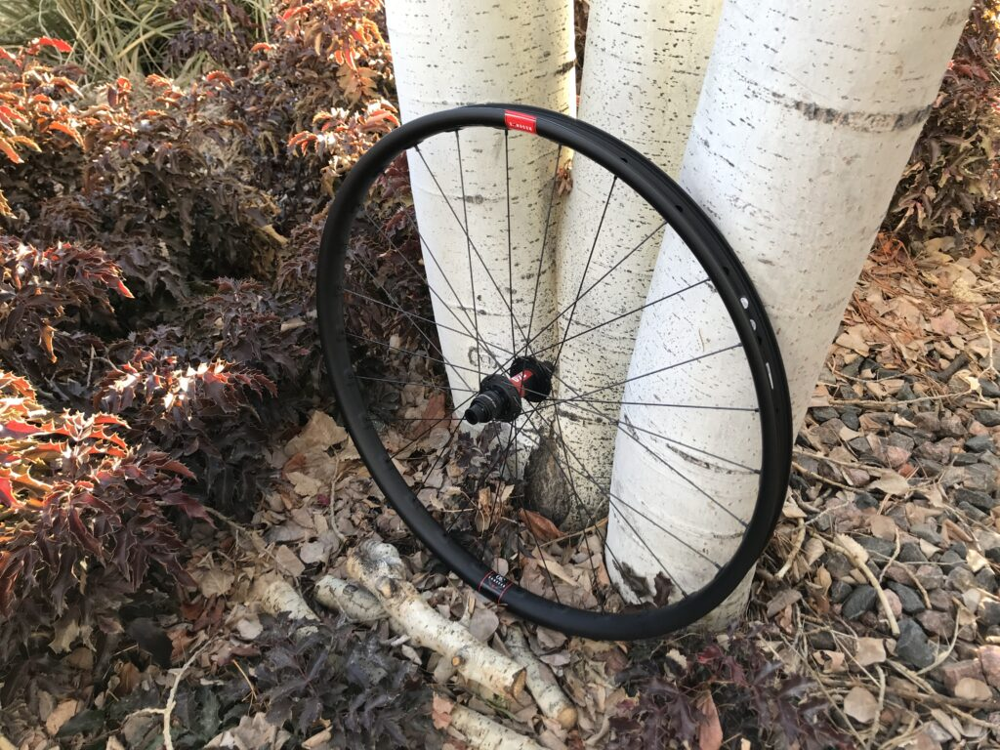

> The latest dream build sports a Reserve 30 SL rim up front and the 30 HD variety out back.
>
> — [FR Wheelworks build notes](https://github.com/kotulc/frwheelworks/blob/main/src/pages/posts/2023/reserve-sl-hd-240-exp-build.md)

The build notes lay out the reasons for choosing a more compliant front rim and a tougher rear rim on the same trail bike. Photo from the original FR Wheelworks post.
