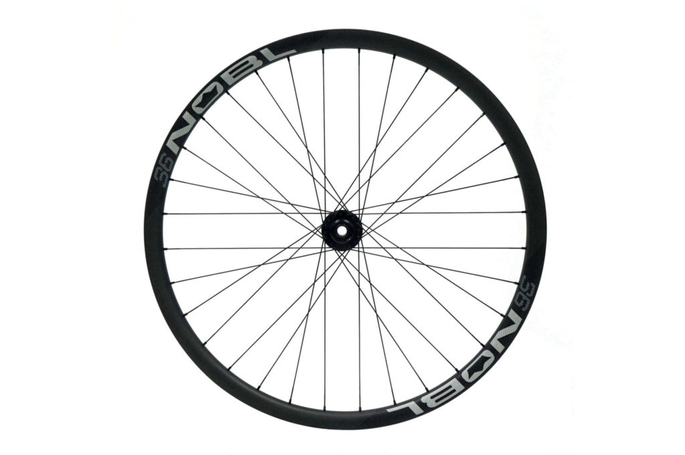

> Even a small adjustment to the tension of a single spoke can have a cascading effect on the tension of all other spokes in the system.
>
> — [FR Wheelworks, *Wheel Building and Neural Networks*](https://github.com/kotulc/frwheelworks/blob/main/src/pages/posts/2023/wheel-building-and-neural-networks.md)

The piece compares successive adjustments in a wheel to iterative optimization. Small changes are a useful place to start when the current state of the whole system matters.
